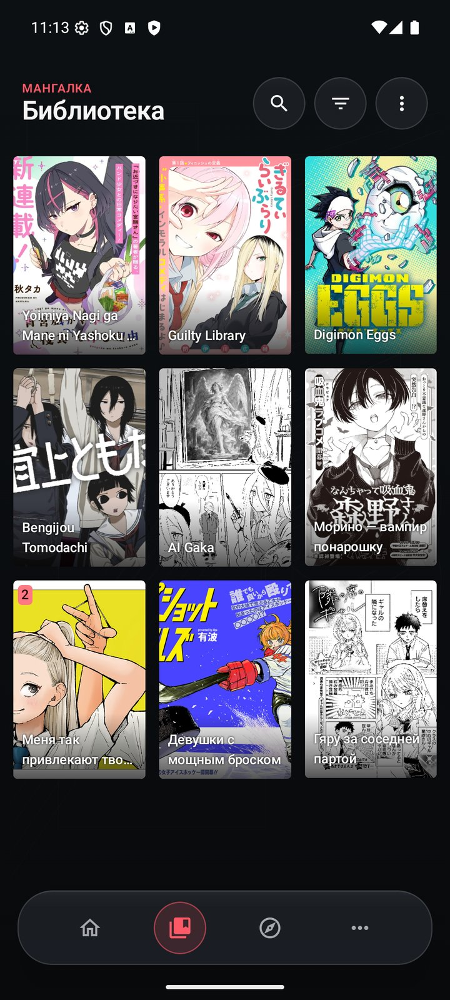
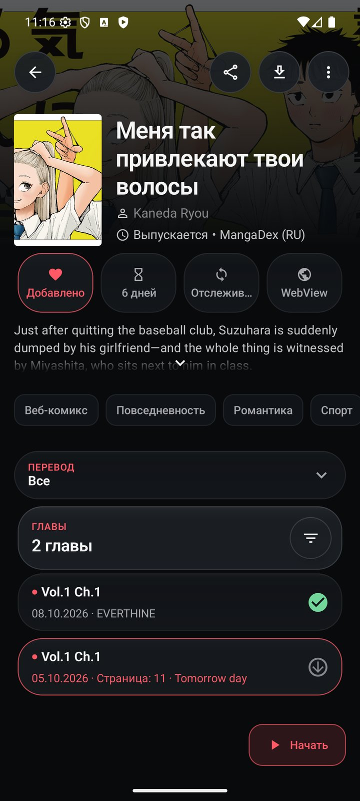
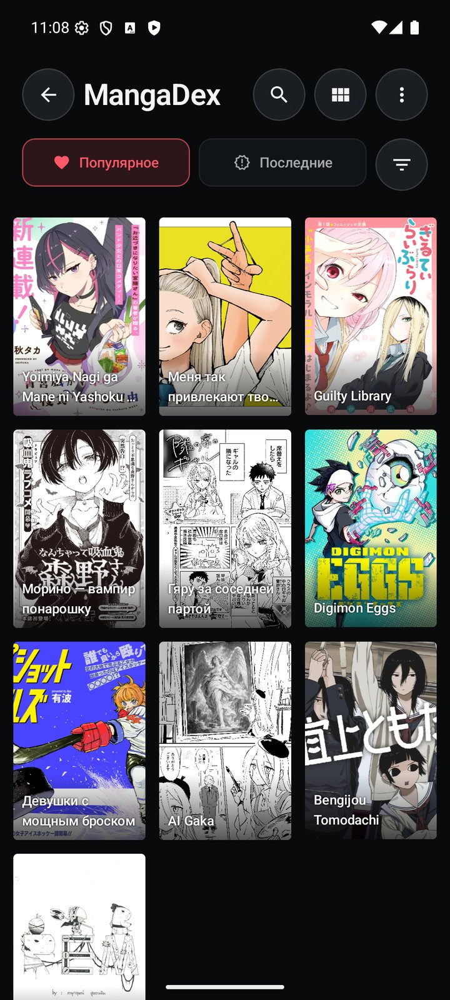
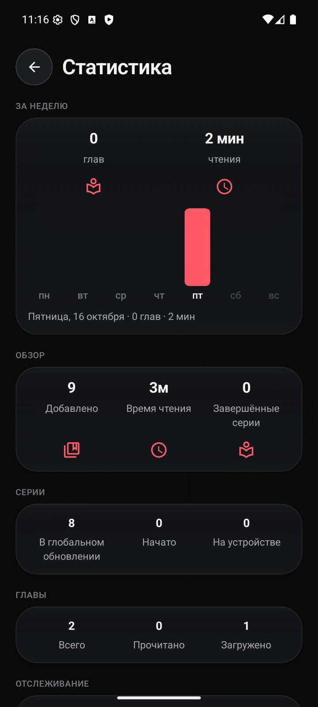

<div align="center">

# Мангалка

**Читалка манги, манхвы и комиксов для Android с тёмным «стеклянным» дизайном.**
Форк [Mihon](https://github.com/mihonapp/mihon): все его возможности на месте, плюс то, чего в нём нет.

[Скачать APK](https://github.com/aaaannnyyd/Mangalka/releases/latest) · Android 8.0+

  
  

</div>

## Чем отличается от Mihon

- **Свой дизайн.** Тёмный графит, стекло, коралловый акцент, плавающая навигация. Главный экран «Сегодня»: продолжить чтение, новые главы, подборки.
- **Когда сайт ломается — понятно, что делать.** Вместо текста исключения: «Сайт изменился», «Сайт не пускает (403)», «Сайт не работает». Кнопки «Обновить расширение» и «Другой источник» прямо на странице тайтла.
- **Автообновление расширений** в фоне по Wi‑Fi — сломавшиеся источники чинятся сами, как только выходит фикс.
- **Умная предзагрузка.** Пока читаете онлайн, по Wi‑Fi скачиваются следующие главы; прочитанные из них удаляются сами.
- **«Похоже на прочитанное».** Подборка по истории чтения через Шикимори — с русскими названиями.
- **Версии с разных сайтов.** Свяжите один тайтл на нескольких источниках и переключайтесь, перенося прочитанное и закладки. В библиотеке одна карточка.
- **Комментарии** с поддерживаемых сайтов (MangaLib, ReManga, Comix и др.) на странице тайтла и в читалке.
- **Статистика за неделю:** время чтения и главы по дням.
- Русский интерфейс из коробки.

## Установка

1. Скачайте APK из [релизов](https://github.com/aaaannnyyd/Mangalka/releases/latest): `arm64-v8a` подходит почти всем современным телефонам, `universal` — если не уверены.
2. Расширения (источники манги) в приложение не входят: добавьте репозиторий расширений в «Каталог → Расширения», как в Mihon.

Мангалка ставится отдельно от Mihon и не мешает ему. Библиотеку можно перенести через резервную копию Mihon (Ещё → Данные и хранилище → Восстановить).

## Сборка

```bash
./gradlew :app:assembleRelease
```

Нужны JDK 21 и Android SDK.

## Лицензия

Apache-2.0, как и у [Mihon](https://github.com/mihonapp/mihon) — огромное спасибо его авторам и сообществу Tachiyomi. Приложение не содержит и не распространяет контент; источники подключаются сторонними расширениями.
