<div align="center">

# Mangalka · Мангалка

**A manga, manhwa and comics reader for Android with a dark glass design.**
**Читалка манги, манхвы и комиксов для Android с тёмным «стеклянным» дизайном.**

[Download APK / Скачать](https://github.com/aaaannnyyd/Mangalka/releases/latest) · Android 8.0+

[English](#english) · [Русский](#русский)

</div>

---

## English

A fork of [Mihon](https://github.com/mihonapp/mihon): everything Mihon does, plus the things below. The interface follows your phone language (English or Russian).

<p align="center">
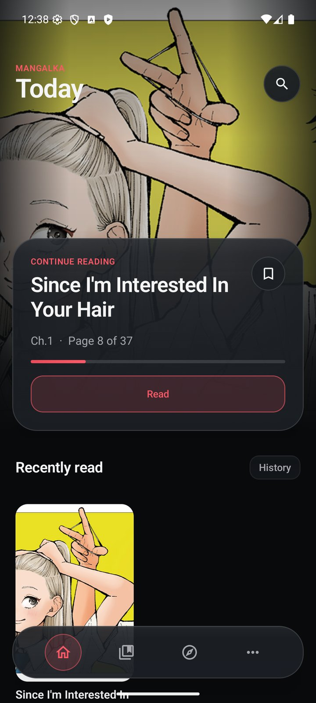 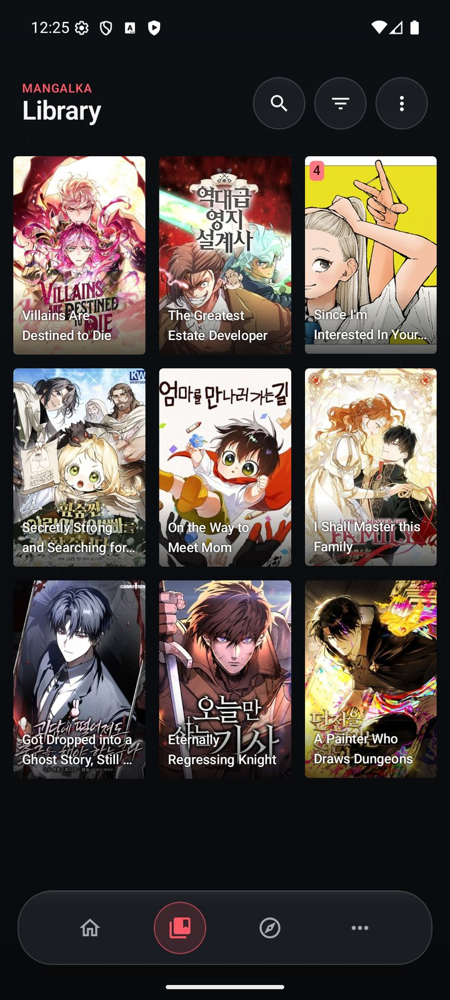 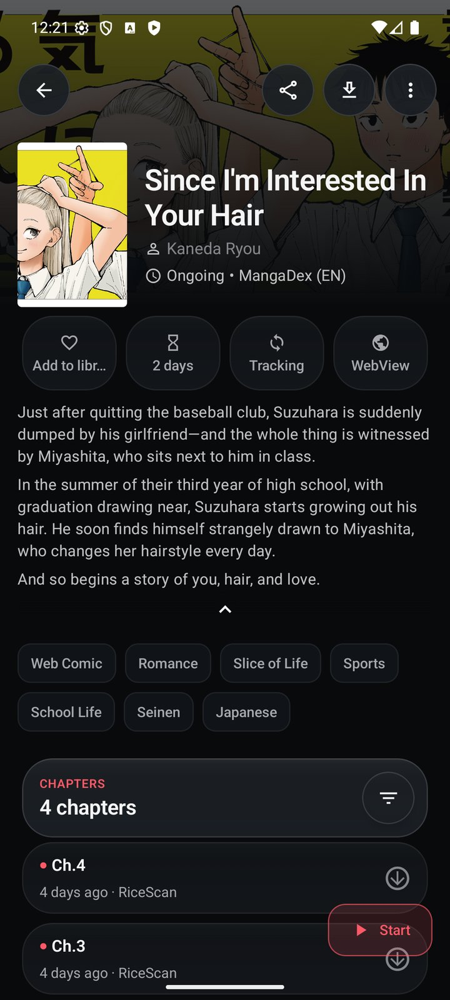 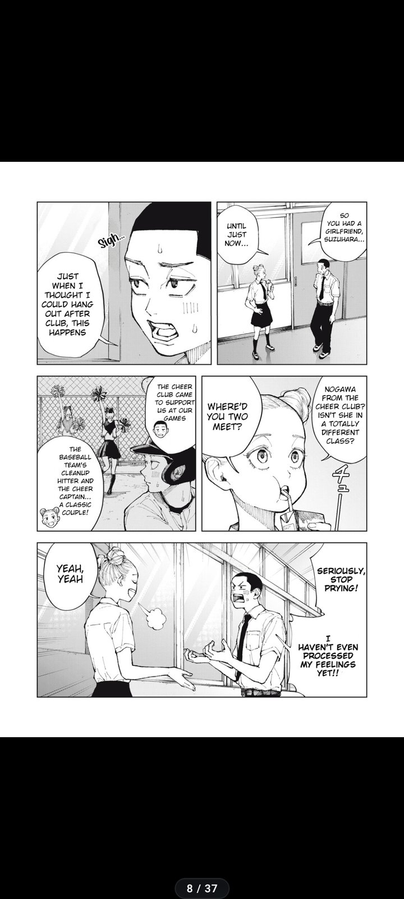
<br/>
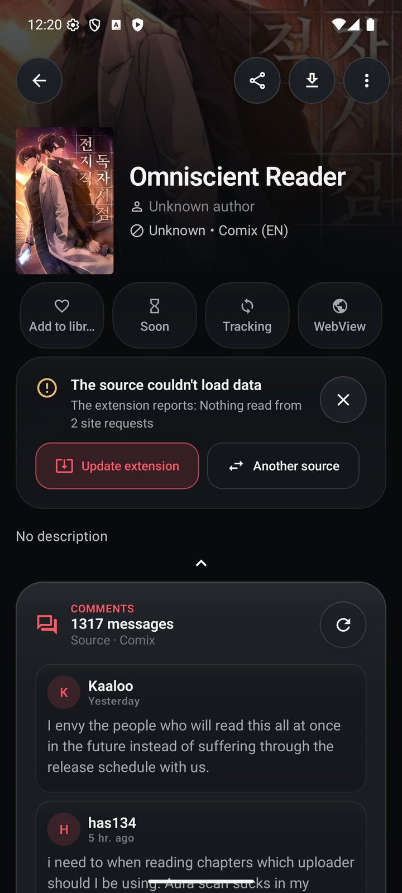 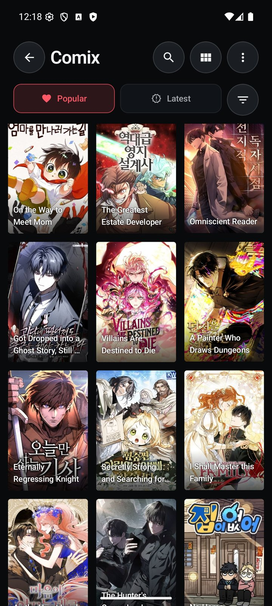 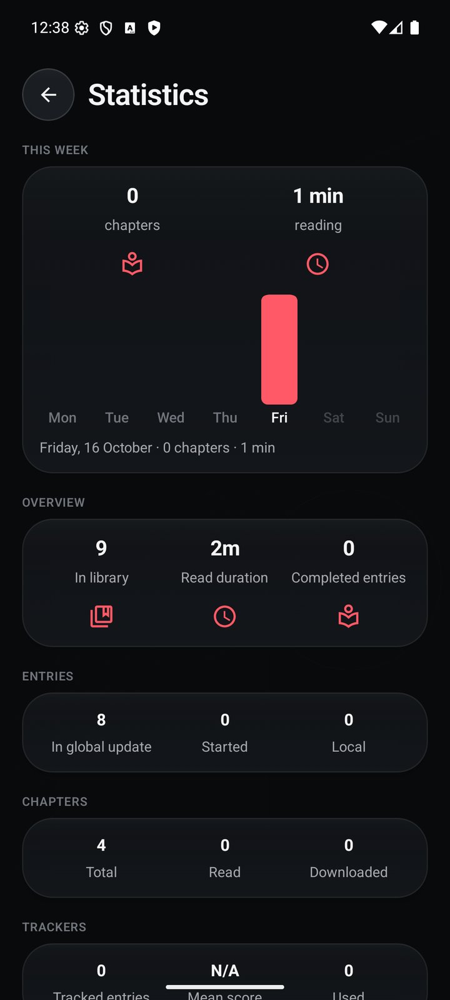
</p>

- **Own design.** Graphite, glass, coral accent, floating navigation. The **Today** screen: continue reading, new chapters, picks.
- **Clear source errors.** Instead of a stack trace: "The site changed", "The site blocks the app (403)", "The site is down". **Update extension** and **Another source** buttons right on the title page.
- **Automatic extension updates** in the background over Wi‑Fi — a broken source fixes itself as soon as the fix ships.
- **Smart prefetch.** While you read online, the next chapters download over Wi‑Fi; read ones are deleted automatically.
- **"Similar to what you read"** — picks based on your history via Shikimori.
- **Editions across sites.** Link the same title on several sources and switch between them, carrying over read chapters and bookmarks. One card in the library.
- **Comments** from supported sites (Comix, MangaLib, ReManga and more) on the title page and inside the reader.
- **Weekly stats:** reading time and chapters per day.

### Install

1. Download an APK from [Releases](https://github.com/aaaannnyyd/Mangalka/releases/latest): `arm64-v8a` fits almost every modern phone, `universal` if unsure.
2. Sources come as separate extensions: add an extension repository in **Browse → Extensions**, as in Mihon.

Mangalka installs alongside Mihon. Move your library with a Mihon backup (**More → Data and storage → Restore**).

---

## Русский

Форк [Mihon](https://github.com/mihonapp/mihon): всё, что умеет Mihon, плюс то, что ниже. Язык интерфейса — как в телефоне (русский или английский).

<p align="center">
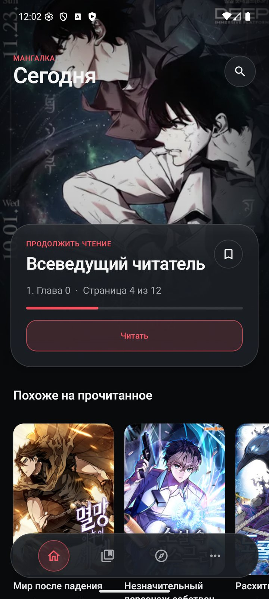 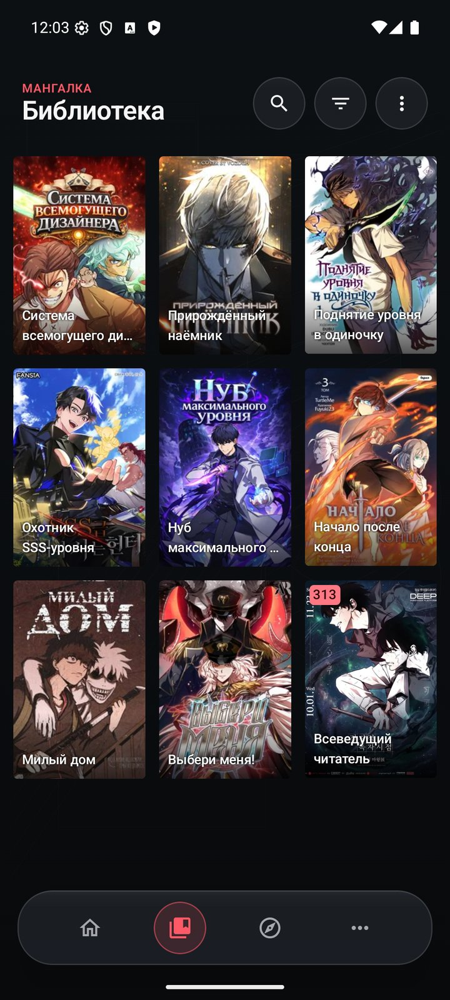 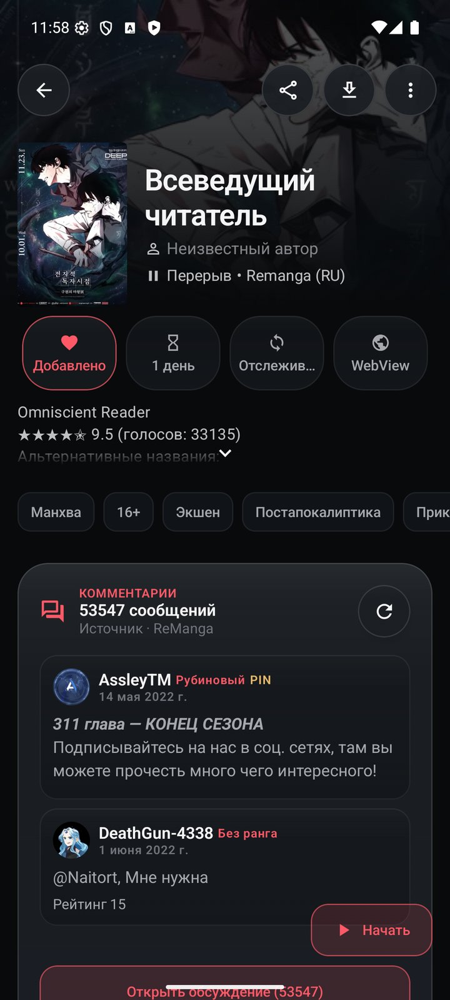 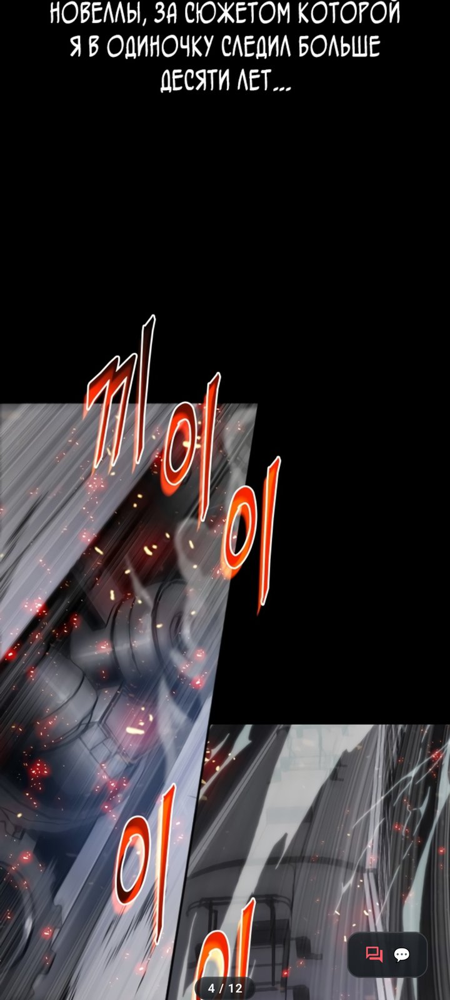
<br/>
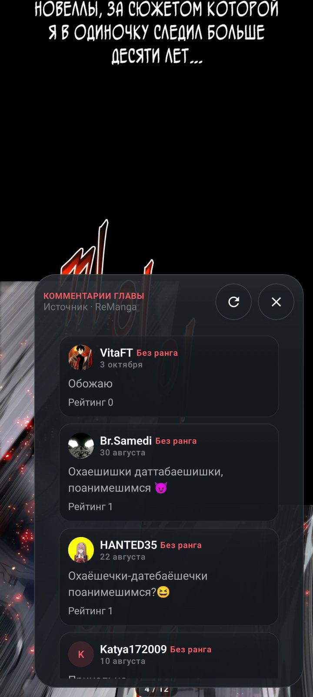 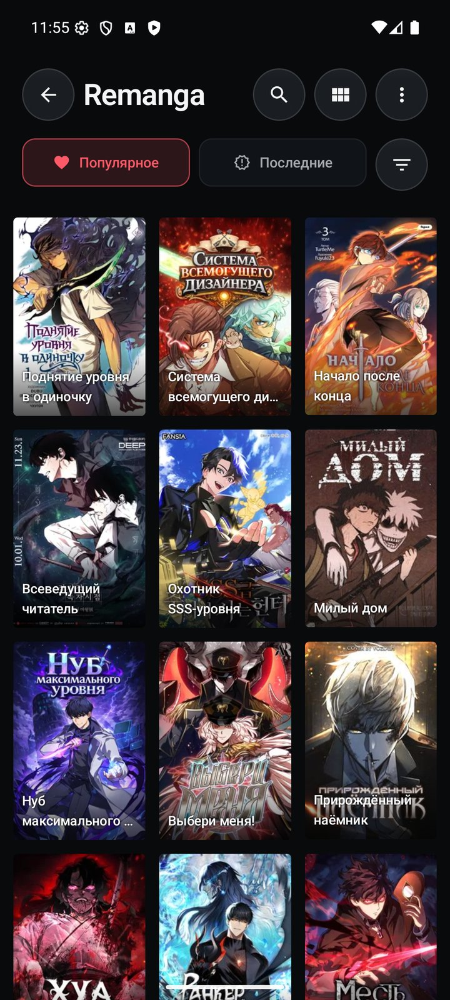 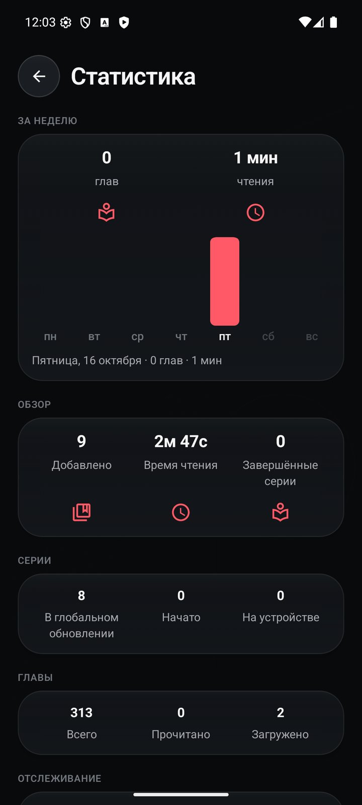
</p>

- **Свой дизайн.** Тёмный графит, стекло, коралловый акцент, плавающая навигация. Экран **«Сегодня»**: продолжить чтение, новые главы, подборки.
- **Понятные ошибки источников.** Вместо стектрейса: «Сайт изменился», «Сайт не пускает (403)», «Сайт не работает». Кнопки **«Обновить расширение»** и **«Другой источник»** прямо на странице тайтла.
- **Автообновление расширений** в фоне по Wi‑Fi — сломавшийся источник чинится сам, как только выходит фикс.
- **Умная предзагрузка.** Пока читаете онлайн, по Wi‑Fi скачиваются следующие главы; прочитанные удаляются сами.
- **«Похоже на прочитанное»** — подборка по истории через Шикимори, с русскими названиями.
- **Версии с разных сайтов.** Свяжите один тайтл на нескольких источниках и переключайтесь, перенося прочитанное и закладки. В библиотеке одна карточка.
- **Комментарии** с сайтов (ReManga, MangaLib, Comix и др.) на странице тайтла и прямо в читалке.
- **Статистика за неделю:** время чтения и главы по дням.

### Установка

1. Скачайте APK из [релизов](https://github.com/aaaannnyyd/Mangalka/releases/latest): `arm64-v8a` подходит почти всем телефонам, `universal` — если не уверены.
2. Источники ставятся отдельно: добавьте репозиторий расширений в **«Каталог → Расширения»**, как в Mihon.

Ставится рядом с Mihon. Библиотеку переносите через резервную копию Mihon (**«Ещё → Данные и хранилище → Восстановить»**).

---

## Build

```bash
./gradlew :app:assembleRelease
```

JDK 21 and the Android SDK are required.

## License

Apache-2.0, like [Mihon](https://github.com/mihonapp/mihon) — many thanks to its authors and the Tachiyomi community. The app contains and distributes no content; sources are provided by third-party extensions.
